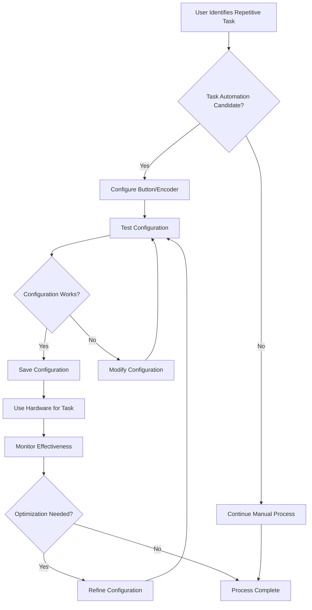
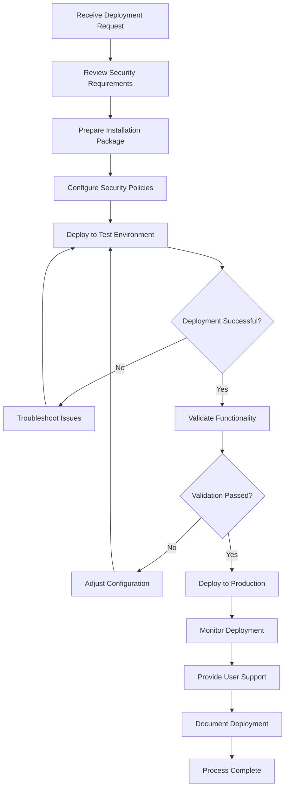
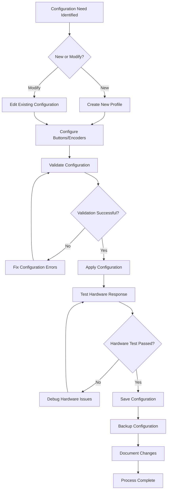
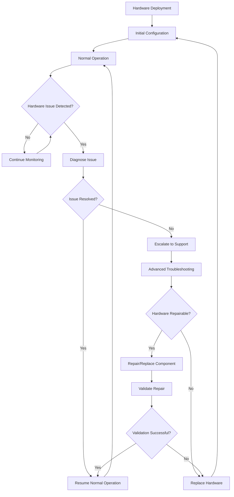
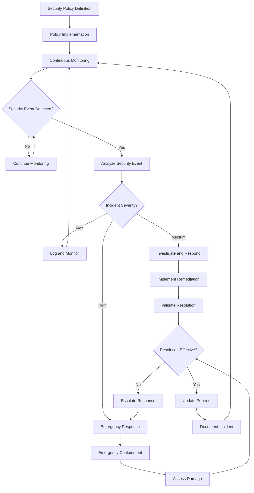

# Business Process Documentation
## Macro Keyboard System

**Document Version**: 1.0  
**Date**: December 2024  
**Purpose**: Document current and future state business processes  

---

## Process Overview

This document maps the business processes supported by the Macro Keyboard System, showing the flow from user needs through system implementation to value delivery. Each process includes current state analysis, future state vision, and transformation requirements.

---

## Core Business Processes

### BP-001: End-User Productivity Enhancement Process

**Process Owner**: End Users  
**Business Value**: Reduce repetitive task time by 60-80%  
**Frequency**: Continuous during work sessions  
**Complexity**: Medium  

#### Current State Process Flow

#### Process Steps Detail

| Step | Description | Duration | Pain Points | System Support |
|------|-------------|----------|-------------|----------------|
| 1. Task Identification | User recognizes repetitive manual task | 1-5 minutes | Manual recognition required | Usage analytics could suggest candidates |
| 2. Configuration Setup | User configures button/encoder action | 2-10 minutes | Learning curve for complex actions | GUI simplifies configuration |
| 3. Testing & Validation | User tests configured action | 1-3 minutes | Trial-and-error refinement | Built-in action testing tools |
| 4. Implementation | User adopts hardware for task | Ongoing | Muscle memory development | Consistent hardware layout |
| 5. Optimization | User refines configuration over time | 5-15 minutes | Identifying improvement opportunities | Performance analytics |

#### Future State Enhancements

**Intelligent Process Discovery**:
- Automatic identification of repetitive patterns
- Suggested automation opportunities
- Machine learning-based optimization recommendations

**Streamlined Configuration**:
- One-click configuration for common patterns
- Template library for typical use cases
- Voice-guided configuration setup

**Continuous Optimization**:
- Automatic performance monitoring
- Usage pattern analysis with suggestions
- A/B testing for configuration alternatives

---

### BP-002: IT Administration and Deployment Process

**Process Owner**: System Administrators  
**Business Value**: Reduce deployment time by 75%, ensure security compliance  
**Frequency**: Per deployment cycle (weekly/monthly)  
**Complexity**: High  

#### Current State Process Flow

#### Process Steps Detail

| Step | Description | Duration | Pain Points | System Support |
|------|-------------|----------|-------------|----------------|
| 1. Requirements Analysis | Review deployment requirements and constraints | 30-60 minutes | Varying requirements across departments | Standardized requirement templates |
| 2. Security Configuration | Configure security policies and restrictions | 45-90 minutes | Complex policy interdependencies | Policy templates and validation |
| 3. Package Preparation | Prepare installation with custom configurations | 20-45 minutes | Manual configuration assembly | Automated package generation |
| 4. Testing & Validation | Test deployment in controlled environment | 60-120 minutes | Limited test environment availability | Automated testing framework |
| 5. Production Deployment | Roll out to production environment | 30-240 minutes | Coordination across multiple systems | Automated deployment tools |
| 6. Monitoring & Support | Monitor deployment success and provide support | Ongoing | Reactive support model | Proactive monitoring and alerts |

#### Future State Enhancements

**Automated Deployment Pipeline**:
- Infrastructure as Code for consistent deployments
- Automated security policy application
- Rollback capabilities for failed deployments

**Self-Service Deployment**:
- Department-specific deployment portals
- Pre-approved configuration templates
- Automated compliance checking

**Predictive Support**:
- Proactive issue detection and resolution
- Automated user onboarding and training
- Performance optimization recommendations

---

### BP-003: Configuration Management Lifecycle

**Process Owner**: End Users, Power Users  
**Business Value**: Reduce configuration time by 50%, improve configuration reliability  
**Frequency**: Initial setup, periodic updates  
**Complexity**: Medium  

#### Current State Process Flow

#### Process Steps Detail

| Step | Description | Duration | Pain Points | System Support |
|------|-------------|----------|-------------|----------------|
| 1. Need Assessment | Identify configuration requirements | 5-15 minutes | Understanding available options | Built-in help and examples |
| 2. Configuration Design | Plan button/encoder assignments | 10-30 minutes | Complex action coordination | Visual configuration designer |
| 3. Implementation | Configure actions and test | 15-45 minutes | Syntax errors and validation issues | Real-time validation and testing |
| 4. Validation | Test complete configuration | 10-20 minutes | Integration testing challenges | Automated configuration testing |
| 5. Deployment | Apply and activate configuration | 2-5 minutes | Configuration conflicts | Hot-reload and conflict resolution |
| 6. Documentation | Document configuration decisions | 5-15 minutes | Maintaining documentation currency | Automated documentation generation |

#### Future State Enhancements

**Configuration Intelligence**:
- Smart configuration suggestions based on usage patterns
- Automatic conflict detection and resolution
- Configuration performance optimization

**Collaborative Configuration**:
- Team-based configuration sharing
- Version control for configuration changes
- Peer review process for complex configurations

**Configuration Analytics**:
- Usage-based configuration optimization
- Performance impact analysis
- Configuration effectiveness metrics

---

### BP-004: Hardware Lifecycle Management

**Process Owner**: End Users, Support Teams  
**Business Value**: Maximize hardware reliability, minimize downtime  
**Frequency**: Continuous monitoring, periodic maintenance  
**Complexity**: Medium  

#### Current State Process Flow

#### Process Steps Detail

| Step | Description | Duration | Pain Points | System Support |
|------|-------------|----------|-------------|----------------|
| 1. Health Monitoring | Continuous hardware health monitoring | Continuous | Manual monitoring requirements | Automated health monitoring |
| 2. Issue Detection | Identify hardware problems early | Real-time | Delayed problem identification | Proactive alert system |
| 3. Diagnosis | Determine root cause of issues | 10-60 minutes | Complex troubleshooting process | Built-in diagnostic tools |
| 4. Resolution | Fix or replace faulty components | 30-240 minutes | Component availability and skills | Self-healing capabilities |
| 5. Validation | Confirm resolution effectiveness | 10-30 minutes | Incomplete testing procedures | Automated validation testing |
| 6. Documentation | Record maintenance actions | 5-15 minutes | Poor maintenance records | Automatic maintenance logging |

#### Future State Enhancements

**Predictive Maintenance**:
- Machine learning-based failure prediction
- Proactive component replacement scheduling
- Automated maintenance task generation

**Remote Management**:
- Remote diagnostic capabilities
- Over-the-air firmware updates
- Remote configuration management

**Self-Healing Systems**:
- Automatic error recovery mechanisms
- Redundant system capabilities
- Graceful degradation during failures

---

### BP-005: Security Management and Compliance

**Process Owner**: Security Teams, System Administrators  
**Business Value**: Maintain security compliance, prevent security incidents  
**Frequency**: Continuous monitoring, periodic audits  
**Complexity**: High  

#### Current State Process Flow

#### Process Steps Detail

| Step | Description | Duration | Pain Points | System Support |
|------|-------------|----------|-------------|----------------|
| 1. Policy Management | Define and maintain security policies | 2-8 hours | Policy complexity and updates | Policy template library |
| 2. Implementation | Deploy policies across systems | 1-4 hours | Consistent policy application | Automated policy deployment |
| 3. Monitoring | Monitor for security policy violations | Continuous | Alert fatigue and false positives | Intelligent alerting system |
| 4. Incident Response | Respond to security incidents | 15 min - 4 hours | Response time and coordination | Automated incident response |
| 5. Remediation | Fix security vulnerabilities | 30 min - 8 hours | Complex remediation procedures | Guided remediation workflows |
| 6. Audit & Compliance | Regular security audits | 4-40 hours | Manual audit processes | Automated compliance reporting |

#### Future State Enhancements

**Automated Security Operations**:
- AI-powered threat detection and response
- Automated policy enforcement and updates
- Self-healing security controls

**Compliance Automation**:
- Continuous compliance monitoring
- Automated audit report generation
- Real-time compliance dashboards

**Risk-Based Security**:
- Dynamic risk assessment and policy adjustment
- Context-aware security controls
- Predictive security analytics

---

## Cross-Process Integration Points

### Integration Matrix

| Process | BP-001 Productivity | BP-002 IT Admin | BP-003 Config Mgmt | BP-004 Hardware | BP-005 Security |
|---------|-------------------|-----------------|-------------------|-----------------|-----------------|
| **BP-001** | - | User onboarding | Configuration sharing | Hardware requests | Security training |
| **BP-002** | Deployment support | - | Policy enforcement | Hardware procurement | Security deployment |
| **BP-003** | Template provision | Configuration standards | - | Hardware compatibility | Security validation |
| **BP-004** | Hardware support | Deployment planning | Config backup | - | Security monitoring |
| **BP-005** | Usage monitoring | Policy compliance | Security validation | Hardware security | - |

### Key Integration Workflows

#### Workflow 1: New User Onboarding
1. **IT Admin** deploys system with security policies (BP-002)
2. **Security** validates policy compliance (BP-005)
3. **User** receives hardware and begins configuration (BP-004, BP-003)
4. **User** starts productivity enhancement process (BP-001)

#### Workflow 2: Configuration Change Management
1. **User** identifies need for configuration change (BP-001)
2. **Security** validates proposed changes against policies (BP-005)
3. **User** implements configuration changes (BP-003)
4. **System** monitors for hardware compatibility (BP-004)

#### Workflow 3: Incident Response
1. **Security** detects policy violation or security incident (BP-005)
2. **IT Admin** investigates and coordinates response (BP-002)
3. **User** may need to modify configuration (BP-003)
4. **System** monitors hardware for compliance (BP-004)

---

## Process Optimization Opportunities

### High-Impact Optimizations

#### 1. Automation Integration
**Current State**: Manual process execution with limited automation  
**Future State**: Intelligent automation with human oversight  
**Benefits**: 60% reduction in process time, 80% reduction in errors  

**Implementation Roadmap**:
- Phase 1: Automate routine validation and monitoring tasks
- Phase 2: Implement intelligent decision support systems
- Phase 3: Deploy full workflow automation with exception handling

#### 2. User Experience Enhancement
**Current State**: Technical configuration requiring expert knowledge  
**Future State**: Intuitive, wizard-driven configuration experience  
**Benefits**: 75% reduction in learning curve, 50% faster configuration  

**Implementation Roadmap**:
- Phase 1: Develop configuration wizards and templates
- Phase 2: Implement intelligent configuration suggestions
- Phase 3: Deploy voice-guided and AI-assisted configuration

#### 3. Predictive Management
**Current State**: Reactive problem identification and resolution  
**Future State**: Proactive prediction and prevention of issues  
**Benefits**: 90% reduction in unplanned downtime, 70% faster resolution  

**Implementation Roadmap**:
- Phase 1: Implement comprehensive monitoring and analytics
- Phase 2: Deploy machine learning for pattern recognition
- Phase 3: Implement predictive analytics and automated responses

### Medium-Impact Optimizations

#### 4. Process Standardization
- Standardize configuration templates across departments
- Implement consistent troubleshooting procedures
- Create unified documentation and training materials

#### 5. Integration Enhancement
- Improve integration with enterprise systems (LDAP, SIEM)
- Develop API connectivity for workflow automation
- Implement single sign-on and identity management

#### 6. Performance Analytics
- Implement process performance dashboards
- Create process optimization recommendations
- Deploy continuous process improvement mechanisms

---

## Process Success Metrics

### Key Performance Indicators (KPIs)

| Process | Primary KPI | Target | Current | Measurement Method |
|---------|-------------|---------|---------|-------------------|
| BP-001 | Task automation efficiency | 70% time reduction | 45% | Time tracking analysis |
| BP-002 | Deployment success rate | 95% | 78% | Deployment monitoring |
| BP-003 | Configuration error rate | <2% | 8% | Validation tracking |
| BP-004 | Hardware uptime | 99.5% | 96% | Availability monitoring |
| BP-005 | Security incident rate | <1 per month | 3 per month | Incident tracking |

### Process Quality Metrics

| Metric | Target | Current | Trend | Action Required |
|--------|--------|---------|--------|----------------|
| User satisfaction | >4.5/5 | 3.8/5 | Improving | UX enhancement |
| Process compliance | 100% | 85% | Stable | Training program |
| Error resolution time | <2 hours | 4 hours | Improving | Automation tools |
| Documentation currency | 95% | 72% | Declining | Documentation automation |
| Training effectiveness | 90% | 68% | Stable | Training redesign |

---

## Process Risk Assessment

### High-Risk Areas

#### Risk 1: Configuration Complexity
**Description**: Complex configuration requirements may overwhelm users  
**Impact**: High - Reduces adoption and effectiveness  
**Probability**: Medium  
**Mitigation**: Implement configuration wizards and template library  

#### Risk 2: Security Policy Conflicts
**Description**: Security policies may conflict with user productivity needs  
**Impact**: Medium - May reduce system utility  
**Probability**: High  
**Mitigation**: Develop risk-based security policies with user consultation  

#### Risk 3: Hardware Reliability
**Description**: Hardware failures may disrupt critical workflows  
**Impact**: High - Business process interruption  
**Probability**: Low  
**Mitigation**: Implement redundancy and quick replacement procedures  

### Medium-Risk Areas

#### Risk 4: Integration Complexity
**Description**: Enterprise integration may be technically challenging  
**Impact**: Medium - Limits enterprise deployment  
**Probability**: Medium  
**Mitigation**: Develop standardized integration frameworks  

#### Risk 5: Support Scalability
**Description**: Support processes may not scale with user growth  
**Impact**: Medium - User satisfaction degradation  
**Probability**: Medium  
**Mitigation**: Implement self-service support tools and automation  

---

## Process Governance

### Process Ownership and Accountability

| Process | Process Owner | Process Manager | Key Stakeholders | Review Frequency |
|---------|---------------|-----------------|------------------|------------------|
| BP-001 | End Users | Product Manager | All users, Support | Monthly |
| BP-002 | IT Director | IT Manager | System admins, Security | Quarterly |
| BP-003 | Power Users | Technical Lead | Users, Developers | Bi-weekly |
| BP-004 | Support Manager | Hardware Specialist | Users, IT, Vendors | Monthly |
| BP-005 | Security Officer | Security Manager | All stakeholders | Weekly |

### Process Improvement Framework

#### Continuous Improvement Process
1. **Monitor**: Continuous monitoring of process performance metrics
2. **Analyze**: Monthly analysis of process effectiveness and efficiency
3. **Identify**: Quarterly identification of improvement opportunities
4. **Implement**: Phased implementation of process improvements
5. **Validate**: Post-implementation validation of improvement effectiveness

#### Change Management Process
1. **Request**: Formal change request with business justification
2. **Review**: Cross-functional review of proposed changes
3. **Approve**: Management approval based on cost-benefit analysis
4. **Implement**: Controlled implementation with rollback capability
5. **Monitor**: Post-implementation monitoring and adjustment

---

This Business Process Documentation provides a comprehensive view of how the Macro Keyboard System supports and enhances organizational workflows, with clear paths for optimization and continuous improvement.