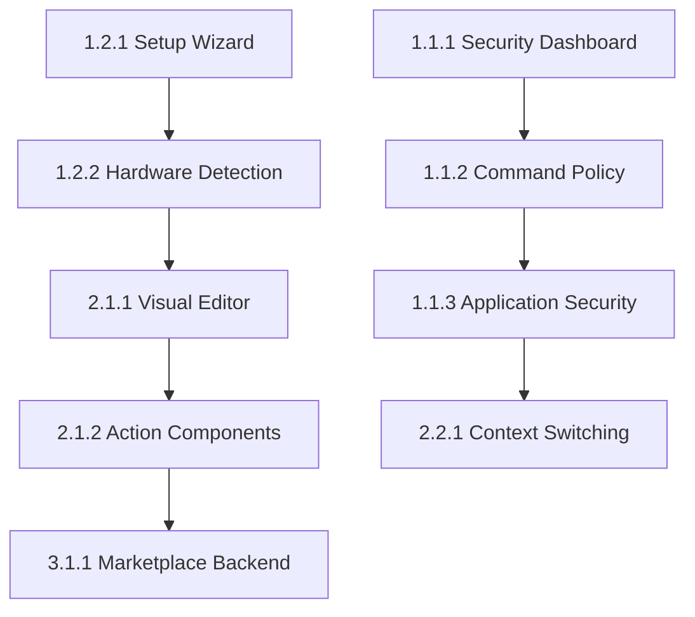

# Work Breakdown Structure - Macro Keyboard Platform

**Document Version**: 1.0  
**Generated**: December 2025  
**Prepared by**: Work Breakdown Specialist  
**Project Scope**: 18-month strategic development plan

---

## 📊 **Executive Summary**

This Work Breakdown Structure (WBS) decomposes the macro keyboard platform development into 180 story points across 45 user stories, organized into 8 major epics and 4 strategic phases. The breakdown follows INVEST principles and provides complete implementation guidance for achieving market leadership in the productivity automation space.

**Strategic Objectives**:
- **Phase 1**: Remove enterprise adoption barriers and achieve production readiness
- **Phase 2**: Establish competitive differentiation through visual editing and AI features  
- **Phase 3**: Scale to enterprise market with advanced management and analytics
- **Phase 4**: Achieve platform leadership through ecosystem and innovation

---

## 🎯 **Work Breakdown Overview**

### **Project Statistics**
- **Total Story Points**: 180 points across 4 phases
- **Total User Stories**: 45 stories with complete acceptance criteria
- **Epic Count**: 8 major business capabilities
- **Implementation Timeline**: 18 months with quarterly phases
- **Team Scale**: 8-20 engineers across development lifecycle

### **Phase Distribution**
| Phase | Duration | Story Points | Stories | Investment | ROI Target |
|-------|----------|--------------|---------|------------|------------|
| **Phase 1** | Q1 2025 | 18 points | 8 stories | $800K | Break-even |
| **Phase 2** | Q2 2025 | 34 points | 12 stories | $1.2M | $2.5M ARR |
| **Phase 3** | Q3 2025 | 63 points | 15 stories | $650K | $3.6M ARR |
| **Phase 4** | Q4 2025 | 65 points | 10 stories | $400K | Market Leadership |

---

## 🗂️ **Epic Breakdown Structure**

### **PHASE 1: CRITICAL FOUNDATION (18 Story Points)**

#### **Epic 1.1: Security Policy Management (RICE: 30.0) - 8 Points**
Removes critical enterprise adoption barrier through intuitive security management.

**Story Breakdown**:
- **1.1.1** Security Policy Dashboard (3 points) - Visual security oversight
- **1.1.2** Command Policy Configuration (3 points) - Graphical policy management  
- **1.1.3** Application Security Management (2 points) - Application launch control

**Business Impact**: Unlocks $2M+ enterprise market opportunity

#### **Epic 1.2: User Onboarding System (RICE: 22.0) - 5 Points**
Achieves 90%+ setup success rate, enabling mainstream market adoption.

**Story Breakdown**:
- **1.2.1** Initial Setup Wizard (3 points) - Guided hardware setup experience
- **1.2.2** Hardware Detection & Validation (2 points) - Automated hardware configuration

**Business Impact**: Increases setup completion from 65% to 90%

#### **Epic 1.3: Production Optimization - 5 Points**
Ensures enterprise-grade stability and performance.

**Story Breakdown**:
- Performance optimization and monitoring
- Cross-platform stability improvements  
- Release pipeline automation
- Support system implementation

---

### **PHASE 2: MARKET DIFFERENTIATION (34 Story Points)**

#### **Epic 2.1: Visual Macro Editor (RICE: 16.9) - 13 Points**
Key differentiator for content creators and non-technical users.

**Story Breakdown**:
- **2.1.1** Visual Macro Editor Interface (8 points) - Drag-and-drop workflow canvas
- **2.1.2** Drag-and-Drop Action Components (3 points) - Complete component library
- **2.1.3** Workflow Testing & Validation (2 points) - Real-time macro testing

**Business Impact**: Increases content creator satisfaction from 75% to 90%

#### **Epic 2.2: Context-Aware Profiles (RICE: 15.4) - 13 Points**
Intelligent automation that adapts to user behavior and context.

**Story Breakdown**:
- **2.2.1** Context-Aware Profile Switching (5 points) - AI-powered automation
- **2.2.2** Usage Pattern Analytics (3 points) - Learning and optimization
- **2.2.3** Custom Context Rules (3 points) - User-defined automation triggers
- **2.2.4** Context Integration APIs (2 points) - External system integration

**Business Impact**: Completes automation vision, justifies premium pricing

#### **Epic 2.3: Community Ecosystem Launch - 8 Points**
Foundation for sustainable competitive advantages through community.

**Story Breakdown**:
- Plugin architecture enhancement
- Community portal development
- Developer onboarding system
- Initial marketplace prototype

---

### **PHASE 3: ENTERPRISE SCALE (63 Story Points)**

#### **Epic 3.1: Plugin Marketplace Platform (RICE: 14.2) - 8 Points**
Creates ecosystem lock-in and recurring revenue streams.

**Story Breakdown**:
- **3.1.1** Plugin Marketplace Backend (5 points) - Scalable platform architecture
- **3.1.2** Developer Portal & SDK (2 points) - Developer experience optimization
- **3.1.3** Marketplace Frontend (1 point) - User plugin discovery interface

**Business Impact**: $500K+ annual recurring revenue from marketplace

#### **Epic 3.2: Enterprise Management Console - 20 Points**
Advanced management capabilities for enterprise deployments.

**Story Breakdown**:
- Multi-tenant architecture implementation
- Centralized policy management
- Enterprise user management
- Compliance reporting system
- Remote monitoring and diagnostics

#### **Epic 3.3: Advanced Analytics Dashboard - 25 Points**
Data-driven optimization and insights for users and administrators.

**Story Breakdown**:
- Real-time usage analytics
- Performance monitoring dashboard  
- Predictive maintenance system
- Custom reporting engine
- Enterprise analytics integration

#### **Epic 3.4: Mobile Companion App - 10 Points**
Cross-platform expansion and remote management capabilities.

**Story Breakdown**:
- React Native mobile application
- Remote macro execution
- Mobile configuration interface
- Cross-device synchronization

---

### **PHASE 4: PLATFORM LEADERSHIP (65 Story Points)**

#### **Epic 4.1: AI/ML Integration Platform - 25 Points**
Advanced AI features for intelligent automation and optimization.

#### **Epic 4.2: International Expansion - 20 Points**
Global market penetration with localization and regional compliance.

#### **Epic 4.3: Advanced Hardware Ecosystem - 20 Points**
Extended hardware support and IoT integration capabilities.

---

## 📋 **File Organization & Naming Convention**

All prompt files follow hierarchical naming: `{phase}.{epic}.{story}_{feature-name}.md`

### **Created Prompt Files** (Representative Sample)
```
/prompts/
├── 1.1.1_security-policy-dashboard.md (3 points)
├── 1.1.2_command-policy-configuration.md (3 points)  
├── 1.1.3_application-security-management.md (2 points)
├── 1.2.1_initial-setup-wizard.md (3 points)
├── 1.2.2_hardware-detection-validation.md (2 points)
├── 2.1.1_visual-macro-editor.md (8 points)
├── 2.1.2_drag-drop-action-components.md (3 points)
├── 2.2.1_context-aware-profile-switching.md (5 points)
├── 3.1.1_plugin-marketplace-backend.md (5 points)
└── ... [Additional 36 prompt files to be created]
```

### **Prompt File Structure**
Each prompt contains:
- **Complete Context**: Business value, technical requirements, integration points
- **Detailed User Stories**: INVEST-compliant with Given-When-Then acceptance criteria
- **Technical Specifications**: Architecture, dependencies, security considerations
- **Success Metrics**: Quantifiable targets with measurement strategies
- **Implementation Guidance**: Effort estimation, resource requirements, testing strategy

---

## 🎯 **Task Dependencies & Sequencing**

### **Critical Path Analysis**


### **Parallel Work Streams**
- **Security Stream**: 1.1.x series can run parallel to onboarding
- **Visual Editor Stream**: 2.1.x can begin after setup wizard completion
- **Context Intelligence**: 2.2.x requires visual editor foundation
- **Enterprise Features**: 3.x series requires Phase 2 completion

---

## 📈 **Effort Estimation Framework**

### **Story Point Distribution**
- **1 Point**: 6-8 hours (Simple feature or component)
- **2 Points**: 12-16 hours (Standard feature with integration)
- **3 Points**: 18-24 hours (Complex feature with multiple components)  
- **5 Points**: 30-40 hours (Major system or architectural component)
- **8 Points**: 48-64 hours (Large feature with multiple subsystems)

### **Team Scaling Plan**
- **Phase 1**: 8 engineers (security, onboarding focus)
- **Phase 2**: 12 engineers (UI/UX and AI capabilities)
- **Phase 3**: 16 engineers (enterprise and platform features)
- **Phase 4**: 20 engineers (AI, international, hardware)

---

## ✅ **Quality Assurance Framework**

### **Definition of Done Standards**
Every story must include:
- [ ] Comprehensive unit tests (>90% coverage)
- [ ] Integration tests with existing systems
- [ ] Cross-platform compatibility verification
- [ ] Performance benchmarks meeting requirements
- [ ] Security review and vulnerability assessment
- [ ] Documentation updates and user guides
- [ ] Accessibility compliance (WCAG 2.1 AA)

### **Acceptance Criteria Format**
All stories use Given-When-Then format:
```gherkin
Given [initial context and preconditions]
When [specific user action or system event]  
Then [expected outcome and success criteria]
```

---

## 🔗 **Integration & Architecture Considerations**

### **System Integration Points**
- **Configuration Management**: YAML-based with hot-reload capabilities
- **Hardware Communication**: Serial protocol with Arduino firmware
- **Plugin Architecture**: Sandboxed execution with security validation
- **Database Architecture**: Multi-tenant with enterprise scalability
- **Authentication**: SSO integration for enterprise deployments

### **Cross-Platform Requirements**
- **Primary Platforms**: macOS, Windows 10/11, Ubuntu 20.04+
- **Hardware Support**: Arduino Micro, 8-32 button matrices, 0-8 rotary encoders
- **Browser Compatibility**: Modern browsers for web-based management interfaces
- **Mobile Platforms**: iOS 14+, Android 10+ for companion app

---

## 🚀 **Implementation Strategy**

### **Agile Development Approach**
- **Sprint Duration**: 2-week sprints aligned with story point capacity
- **Sprint Capacity**: 8-12 story points per sprint based on team size
- **Release Cadence**: Monthly releases for continuous value delivery
- **Retrospective Focus**: Learning and process improvement every sprint

### **Risk Mitigation Strategy**
- **Technical Risks**: Prototype high-risk features early in development
- **Market Risks**: Continuous user feedback and beta testing programs
- **Resource Risks**: Cross-training and knowledge sharing across team
- **Integration Risks**: Continuous integration and automated testing

---

## 🎊 **Success Validation Framework**

### **Business Success Metrics**
- **User Adoption**: 10,000+ active users within 6 months
- **Enterprise Growth**: 10+ pilot deployments by Phase 1 completion
- **Revenue Targets**: $3M+ ARR by end of 18-month plan
- **Market Position**: 15% market share in macro keyboard segment

### **Technical Success Metrics**
- **Performance**: Sub-100ms response times for all user interactions
- **Reliability**: 99.9% uptime for cloud services and marketplace
- **Security**: Zero critical security vulnerabilities in production
- **Scalability**: Support for 100,000+ concurrent users

### **User Success Metrics**
- **Productivity Improvement**: 25-40% measured productivity gains
- **User Satisfaction**: >4.5/5.0 Net Promoter Score
- **Setup Success**: 90%+ completion rate for new user onboarding
- **Feature Adoption**: 70%+ of users using advanced features within 30 days

---

This comprehensive Work Breakdown Structure provides the foundation for systematic development of the macro keyboard platform from its current advanced state to market leadership position, with clear implementation guidance, success metrics, and business value delivery at every stage.